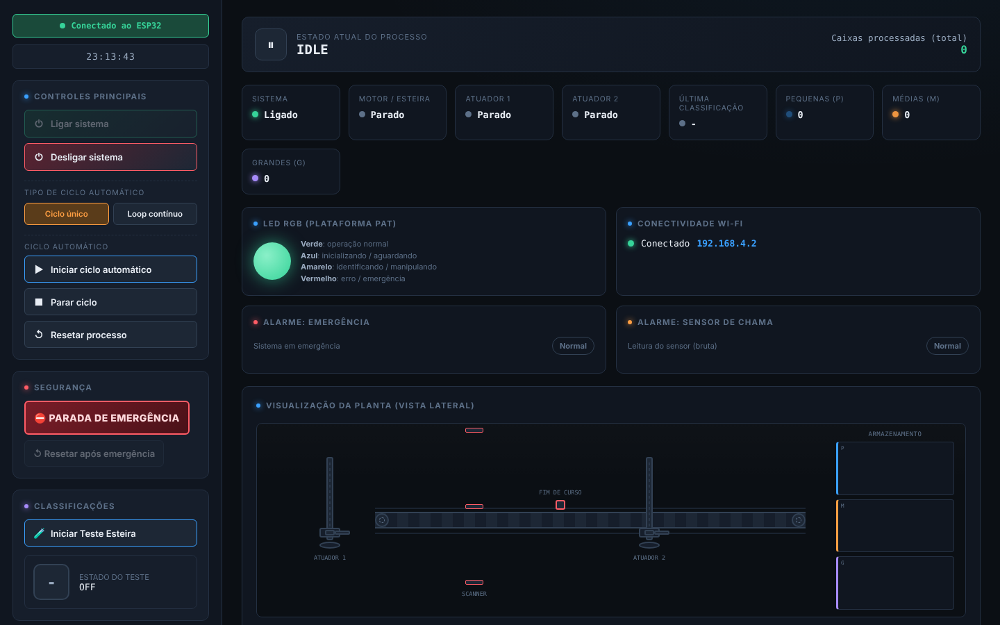
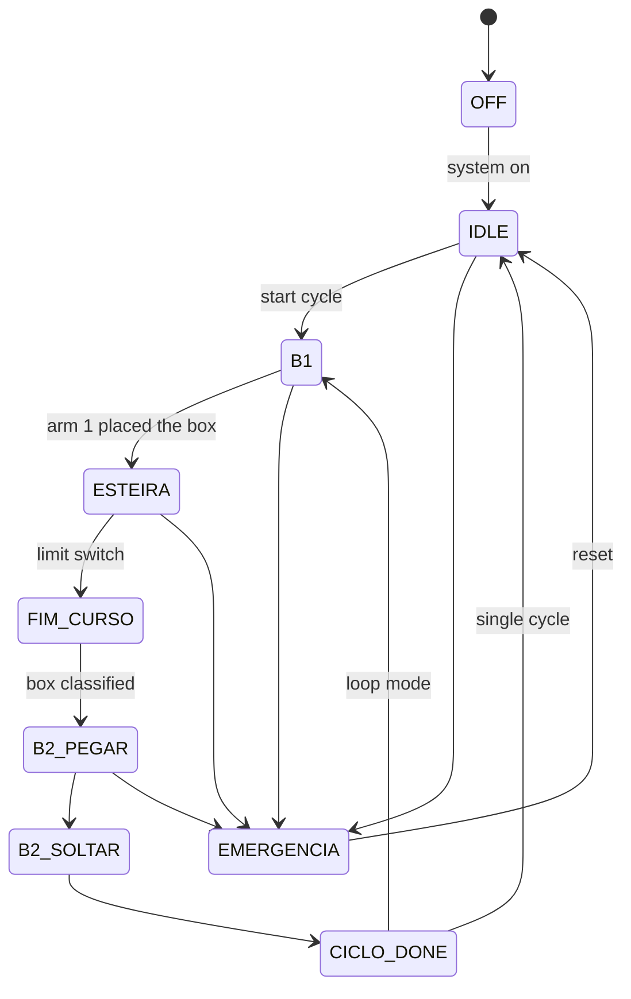

# Automated Box Sorting System

Group project that classifies boxes as small (P), medium (M) or large (G) on a conveyor belt and moves them with two robotic arms. An ESP32 runs all the decision logic and a web control panel, and an Arduino Mega with a RAMPS 1.4 shield drives the stepper motors.



## Overview

Final project of the Microcontroller Systems course at UTFPR (2026). A first arm places a box on the conveyor, three infrared barriers measure its height while it passes, a limit switch stops the belt at the end, and a second arm picks the box up. The system is controlled and monitored from a web page, a local OLED display, an RGB LED and a buzzer. It has an emergency mode triggered by a button, the web page or a dedicated alarm sensor, and a separate high temperature alarm.

## System architecture

The two boards have separate roles:

- **ESP32 (PAT-DAELN v2.1 board): decides everything.** State machine, classification, conveyor on and off, emergency handling, web server, OLED, RGB LED and event log.
- **Arduino Mega 2560 + RAMPS 1.4: executes.** Runs the motor sequences it receives and reports the raw state of the sensors. It makes no classification decisions.

The ESP32 firmware uses both cores with FreeRTOS:

| Core | Task | Work |
|---|---|---|
| 0 | `TaskControle` | State machine, classification, arm and conveyor commands, I2C polling of the Mega, conveyor test |
| 1 | `TaskComunicacao` | Wi-Fi, web server, OLED, RGB LED, event log |

Only core 0 talks to the I2C bus. Core 1 reads a copy of the system state protected by a mutex, and log messages go from core 0 to core 1 through a FreeRTOS queue.

### Communication with the Mega (I2C, address 0x08)

- **ESP32 to Mega, commands:** `pp` / `sp` (arm 1 pick / place), `pp2` / `sp2` (arm 2 pick / place), `ce` / `cd` (conveyor on / off), `em` / `em0` (emergency on / off, aborts any movement in progress).
- **Mega to ESP32, sensors:** one byte with the three infrared barriers, the limit switch, the alarm sensor and a heartbeat bit that toggles on every loop of the Mega, so the ESP32 can tell when the Mega stops responding.

### Classification

While the belt runs, each infrared barrier (KY-032) that sees the box for 3 consecutive readings stays marked until the end of the run. When the limit switch fires, the belt stops and the box is classified by how many barriers were triggered: 1 is small, 2 is medium and 3 is large.

### State machine



Emergency can interrupt any state. It has three sources: the S4 button on the board (hardware interrupt), the web page and the alarm sensor read by the Mega (polled over I2C). In emergency the buzzer plays a siren, the LED turns red and the Mega aborts its movements. Reset (S6 button or web page) returns to idle, or to off if the system was switched off, and leaves the arms where they stopped.

The temperature alarm is separate from the emergency. When the LM35 reads 45 °C or more, the ESP32 stops the conveyor, keeps the buzzer on, turns the LED red and pauses the state machine. It does not abort the arm movements on the Mega. The alarm clears by itself when the temperature falls to 40 °C or less, without a reset.

A separate conveyor test mode runs the belt, classifies one box using only the sensors and updates the same counters, without moving the arms.

## Hardware

| Part | Use |
|---|---|
| ESP32 on PAT-DAELN v2.1 | Main controller, OLED (SSD1306), RGB LED, buzzer, S4 and S6 buttons |
| LM35 on GPIO36 | Temperature alarm |
| Arduino Mega 2560 + RAMPS 1.4 | Motor drivers and sensor inputs |
| 3 NEMA 17 (A4988) | Lift of arm 1, lift of arm 2, conveyor |
| 2 28BYJ-48 (ULN2003) | Fork of each arm |
| 2 AK85H (MA860H driver) | Base rotation of each arm |
| 3 KY-032 infrared sensors and a limit switch | Box height and end of belt |
| Boolean alarm sensor on the Mega | Simulated fire detection |

## Web control panel

The ESP32 serves a single page that polls `/status` every second over HTTP. It turns the system on and off, starts single or continuous cycles, stops and resets the process, triggers and resets the emergency, runs the conveyor test and shows the counters, the RGB LED state, Wi-Fi status, the alarms and an animated side view of the plant. The page is stored in the firmware itself.

## Current limitations

- **Destination per category:** both arms make the same movement for every box, so boxes are classified and counted but not yet placed in a different compartment per category.
- **Movement timing:** the Mega does not report when a movement ends, so the automatic cycle waits a fixed 11 s for each arm movement.
- **Classification accuracy:** not formally measured with a series of repeated tests.
- **Mega firmware:** the final version of the Arduino Mega firmware is not in this repository. The command protocol it implements is described above.

## Repository structure

```
firmware/esp32/box_sorting_esp32/box_sorting_esp32.ino   ESP32 firmware, including the web page
images/                                                   screenshots
```

Comments in the firmware are in Portuguese.

## How to build

- Arduino IDE with the ESP32 core 3.x (the firmware uses the 3.x timer and LEDC API)
- Libraries: Adafruit GFX and Adafruit SSD1306
- Set `ssid` and `password` at the top of the file before uploading

## Credits

Final project of the Microcontroller Systems course at UTFPR by Gabriela Bosco Azevedo, Felipe Martins and Lucas Hemann Horn.

## Attribution and usage

This repository is shared for portfolio and educational purposes. It is a group project by Gabriela Bosco Azevedo, Felipe Martins and Lucas Hemann Horn. No license is granted for reuse or redistribution of the code, images or text. If you want to use any of it, please contact me on [LinkedIn](https://www.linkedin.com/in/felipe-m-k-m-martins).

## Author

Felipe Martins, Mechatronics Engineering student at UTFPR, double degree at ENSTA.
[LinkedIn](https://www.linkedin.com/in/felipe-m-k-m-martins)
